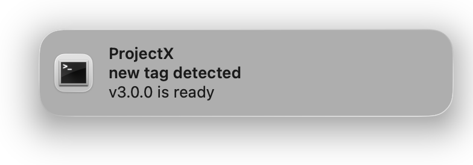
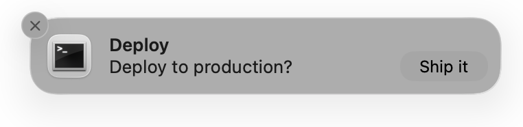
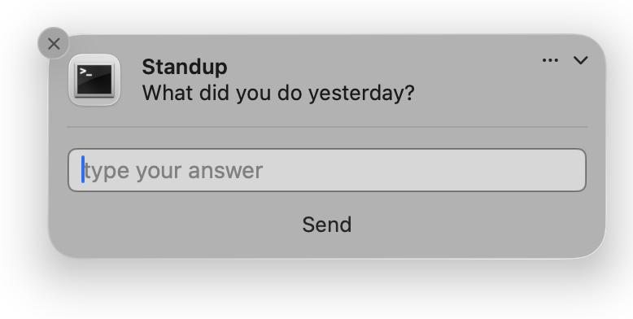

# terminal-notifier

[](https://github.com/julienXX/terminal-notifier/releases)

terminal-notifier is a command-line tool to send macOS User Notifications.

```
$ terminal-notifier -title 'Build' -message 'Finished in 42s' -sound default
```

Requires macOS 10.14 or higher.

**Upgrading from 2.x?** See [Differences from version 2](#differences-from-version-2).


## Contents

* [Installation](#installation)
* [Usage](#usage)
* [Options](#options)
* [Interactive notifications](#interactive-notifications)
* [Examples](#examples)
* [When notifications do not appear](#when-notifications-do-not-appear)
* [Custom icons](#custom-icons)
* [Building from source](#building-from-source)
* [Differences from version 2](#differences-from-version-2)
* [Using it from Ruby](#using-it-from-ruby)
* [License](#license)


## Installation

With [Homebrew](https://brew.sh):

```
$ brew install terminal-notifier
```

Or download a prebuilt binary from the
[releases page](https://github.com/julienXX/terminal-notifier/releases).

Or build it yourself, see
[Building from source](#building-from-source):

```
$ make install
```

⚠️ terminal-notifier is not notarized and I don't want to pay the Apple tax for
now. macOS quarantines anything you download so the first run is blocked.
To work around this:

```
$ xattr -dr com.apple.quarantine /path/to/terminal-notifier.app
```

This only affects downloaded copies. Homebrew and `make install` are not
quarantined so they need nothing.


## Usage

```
$ terminal-notifier -[message|remove|list] [VALUE|ID|ID] [options]
```

At a minimum you must give one of `-message`, `-remove` or `-list`.

If you downloaded the app bundle rather than installing it, call the binary
_inside_ it:

```
$ ./terminal-notifier.app/Contents/MacOS/terminal-notifier -message 'Hello'
```

A notification is attributed to an application, so the terminal-notifier ships as an app
bundle rather than a bare executable.

### Escaping

Option values are read through `NSUserDefaults`, which tries to parse each one
as a property list. A value whose **first character** is `[`, `(`, `{`, `"` or
similar is misread and the notification is not sent. Escape it with a
backslash:

```
$ terminal-notifier -message '\[ZOMG] Everything is on fire'
```

Only the first character ever needs this. Since 3.0.0 terminal-notifier tells you when a
value could not be read instead of failing silently.


## Options

### Required (one of)

#### `-message VALUE`

The body of the notification.

```
$ terminal-notifier -message 'Finished in 42s'
```


The title defaults to `Terminal`, which is why it appears above.

Can be omitted if you pipe data in instead, the piped text then becomes the body:

```
$ echo 'Deploy finished' | terminal-notifier
```

#### `-remove ID`

Remove previously delivered notifications in the `ID` group. Use `ALL` to
remove every notification terminal-notifier has posted.

```
$ terminal-notifier -remove build
$ terminal-notifier -remove ALL
```

`-remove` also cancels a notification that was scheduled with `-in` or `-at` and
has not fired yet. Schedule it with a `-group`, and later remove that group:

```
$ terminal-notifier -message 'Backup starting' -group backup -at 02:00
$ terminal-notifier -remove backup
```

The second command cancels the first, so no notification is shown at 02:00.
Without a `-group` a scheduled notification has no name to remove by, and only
`-remove ALL` can cancel it.

#### `-list ID`

List delivered notifications in the `ID` group or `ALL` for every one. Output
is tab separated with a header row:

```
GroupID   Title      Subtitle   Message           Delivered At
build     Terminal              Finished in 42s   2026-08-23 10:22:16 +0000
```

Tabs and newlines inside a field are replaced with spaces, so each notification
is always exactly one row of five columns. An absent field is empty.

Use `PENDING` to see what `-in` and `-at` have scheduled that has not fired yet.
The last column is when each one is due, and the soonest is listed first:

```
$ terminal-notifier -list PENDING
GroupID   Title      Subtitle   Message           Scheduled For
backup    Terminal              Starting          2026-09-01 02:00:00 +0000
```

A scheduled notification is listed here until it fires, and by `-list ALL` after
it has, never by both.

### Content

#### `-title VALUE`

The title. Defaults to `Terminal`.

```
$ terminal-notifier -title 'Build' -message 'Finished in 42s'
```


Note that on macOS 11 and later the notification also shows the name of the
application that sent it.
[Custom icons](#custom-icons) explains how to change it.

#### `-subtitle VALUE`

The subtitle, shown between the title and the message.

```
$ terminal-notifier -title 'ProjectX' -subtitle 'new tag detected' -message 'v3.0.0 is ready'
```



#### `-sound NAME`

Play a sound when the notification appears. Names come from the files in
`/System/Library/Sounds`. Use `default` for the standard notification sound.

```
$ terminal-notifier -message 'Done' -sound Glass
```

A name that does not match a file is ignored and the notification is delivered
with the default sound.

#### `-contentImage PATH`

Attach an image shown inside the notification.

```
$ terminal-notifier -title 'Report' -subtitle 'weekly summary' -message 'Chart attached' -contentImage ./chart.png
```


Local files only in a format macOS recognises (PNG, JPEG, GIF).
If the file is missing or unusable terminal-notifier says so and delivers the
notification without it.

To change the notification's **icon** rather than attach an image, see
[Custom icons](#custom-icons).

#### `-group ID`

Group notifications under `ID`. Only one notification per group is ever shown.
Posting again to the same group replaces the previous one (eg. for progress or status updates).

```
$ terminal-notifier -message 'Step 1 of 3' -group deploy
$ terminal-notifier -message 'Step 2 of 3' -group deploy   # replaces the above
```

Without `-group`, every notification is separate and they accumulate.

Useful group IDs are terminal-notifier's name (to scope by tool), `$$` (to scope by
process) or `$PWD` (to scope by project).

### Click actions

These run when the user clicks the notification body. What happened is written
to the system log. Read it with Console.app.

#### `-open URL`

Open a URL. Web, file or any custom scheme.

```
$ terminal-notifier -message 'Build failed' -open 'https://ci.example.com/build/42'
$ terminal-notifier -message 'Reply needed' -open 'msteams:/l/chat/0/0'
```

Any scheme works, including deeplinks with no host such as `msteams:`,
`mailto:` and `tel:`. The value needs a scheme, so pass a file as
`file:///path` rather than a bare path.

#### `-execute COMMAND`

Run a shell command.

```
$ terminal-notifier -message 'Logs ready' -execute 'open -a Console /tmp/build.log'
```

The command runs through `/bin/sh -c` in a non-interactive shell, so your
dotfiles are not loaded and `PATH` may be smaller than in your terminal. Use
absolute paths.

#### `-activate BUNDLE_ID`

Bring an application to the front.

```
$ terminal-notifier -message 'Tests passed' -activate 'com.apple.Terminal'
```

Find an app's identifier with:

```
$ osascript -e 'id of app "Safari"'
```

### Interactive

These make terminal-notifier **wait** for the user and print the outcome on stdout. See
[Interactive notifications](#interactive-notifications).

#### `-action TITLE`

Add an action button. Pass a comma separated list or repeat the option:

```
$ terminal-notifier -message 'Deploy?' -action 'Yes,No'
$ terminal-notifier -message 'Deploy?' -action Yes -action No
```



macOS reveals the button when you hover the notification or shows it
immediately if you have set the style to Alerts.

A single action is drawn as a plain button, as above. Give it more than one and
macOS collapses them into an **Options** menu instead.

#### `-reply [PROMPT]`

Add a text field, optionally with placeholder text. Prints what was typed.

```
$ answer=$(terminal-notifier -title 'Standup' -message 'What did you do yesterday?' -reply 'type your answer')
```



#### `-timeout SECONDS`

How long to wait for `-action` or `-reply`. Without it terminal-notifier waits forever.
On expiry it prints `@TIMEOUT` and exits 6.

Has no effect on any other mode which all return immediately.

### Scheduling

#### `-in DURATION`

Deliver after a delay instead of immediately. A bare number means seconds, or add
a unit: `s`, `m`, `h`, `d`.

```
$ terminal-notifier -message 'Tea is ready' -in 3m
$ terminal-notifier -message 'Stand up' -group posture -in 90
```

terminal-notifier hands the notification to macOS and exits straight away — it does
not stay running to wait for it. The notification arrives even though the shell
that scheduled it is long gone.

#### `-at TIME`

Deliver at a given time rather than after a delay. A clock time means the next time
the clock reads that, today or tomorrow. A full date means one specific moment.
Both are in local time.

```
$ terminal-notifier -message 'Standup' -at 09:15
$ terminal-notifier -message 'Backup starting' -at '2026-09-01 02:00'
```

The date form must be written `YYYY-MM-DD HH:MM`. A date in the past is an error,
rather than a notification that silently never arrives.

A clock time is never in the past, because there is always a next one. It has to
still be coming up this minute, though: run `-at 09:15` at 09:15:30 and you get
09:15 tomorrow.

Cannot be combined with `-in`.

#### Notes on scheduling

`-action` and `-reply` cannot be scheduled. Their result is printed on stdout, and
terminal-notifier exits as soon as the notification is registered, so nothing would
be left listening for it.

Give a scheduled notification a `-group` if you may want to cancel it. Without one
it has no handle, and only `-remove ALL` will clear it.

`-open`, `-execute` and `-activate` work as usual: they are stored with the
notification and run when it is eventually clicked. Note that `-execute` then runs
in the graphical session's environment, not the one that scheduled it.

Once scheduled, the notification is held by macOS rather than by terminal-notifier,
which is why it still arrives with the shell long gone. Use `-list PENDING` to
check what is actually waiting.

### Diagnostics

#### `-diagnose`

Report everything that decides whether a notification appears, then exit:
authorization status, alert style, sound and preview settings, whether
Notification Center is running and whether Scheduled Summary is holding
notifications back. Any problems found are listed with how to fix them.

```
$ terminal-notifier -diagnose
```

Exits non-zero if notifications are not authorized. Start here when nothing
shows up.

#### `-help`, `-version`

Print the help banner or the version.

### Removed

These are still accepted so existing scripts keep running. They print a warning
and are otherwise ignored. The notification is still delivered.

#### `-sender BUNDLE_ID`

**Removed in 3.0.0.** It worked by swizzling terminal-notifier's own bundle
identifier at runtime, which the `UserNotifications` framework does not allow.
It reads the real, signed identity. Use `-activate` to bring an app forward on
click.

#### `-appIcon PATH`

**Removed in 3.0.0.** macOS has no API to override a notification's icon. It
always comes from the sending app's bundle. See [Custom icons](#custom-icons)
for the way around this.

#### `-ignoreDnD`

**Effectively removed in 3.0.0.** It used to set a private flag. The public
equivalent needs an entitlement Apple grants on request, which the released
binary does not carry so this option is accepted but does nothing.


## Interactive notifications

`-action` and `-reply` behave differently from every other option: terminal-notifier
**stays running** until the user responds then prints the outcome on stdout.
That is what lets a script use the answer.

```
$ answer=$(terminal-notifier -message 'Deploy to production?' -action 'Yes,No' -timeout 30)
$ case "$answer" in
    Yes)      ./deploy.sh ;;
    No)       echo 'cancelled' ;;
    @TIMEOUT) echo 'no answer, not deploying' ;;
  esac
```

The output is one of:

| Output | Meaning |
|---|---|
| the button's title | that button was clicked |
| the typed text | `-reply` was answered |
| `@ACTIONCLICKED` | the notification body was clicked, not a button |
| `@CLOSED` | the notification was dismissed |
| `@TIMEOUT` | `-timeout` expired (exit code 6) |

Because the process waits, always pass `-timeout` in an unattended script
otherwise it blocks forever.


## Examples

Notify when a long command finishes, whatever its result:

```
$ make build; terminal-notifier -message "build finished ($?)" -sound default
```

Pipe output straight in:

```
$ echo 'Piped Message Data!' | terminal-notifier -sound default
```

Open a URL on click:

```
$ terminal-notifier -title '💰' -message 'Check your Apple stock!' -open 'https://finance.yahoo.com/q?s=AAPL'
```

Activate an app on click, replacing the previous notification each time:

```
$ terminal-notifier -group 'address-book-sync' -title 'Address Book Sync' \
    -subtitle 'Finished' -message 'Imported 42 contacts.' -activate 'com.apple.AddressBook'
```

Ask a question and wait for the answer:

```
$ terminal-notifier -message 'Deploy to production?' -action 'Yes,No' -timeout 30
```

Show progress under one notification, then clear it:

```
$ for step in 1 2 3; do
    terminal-notifier -message "Step $step of 3" -group work
    sleep 2
  done
$ terminal-notifier -remove work
```


## When notifications do not appear

Start with:

```
$ terminal-notifier -diagnose
```

It reports the authorization status, the alert style, whether sounds are
enabled, whether Notification Center is running and whether Scheduled Summary
is holding notifications back. It lists what to fix.

The usual causes:

* **Permission was never granted or was reset.** macOS asks once, the first
  time. An OS upgrade or migration can clear it.
* **A Focus mode is on.** Focus suppresses notifications silently.
* **Scheduled Summary** is collecting them into a digest instead of showing
  them now.
* **Notification Center has crashed.** `killall NotificationCenter` restarts it.
* **No GUI session.** Notifications belong to a logged-in user, so they cannot
  be posted over SSH or from a launchd daemon running as root. terminal-notifier reports
  this rather than hanging.

To make macOS ask for permission again:

```
$ tccutil reset UserNotification fr.julienxx.oss.terminal-notifier
```

`tccutil` resolves that identifier through LaunchServices, so the app bundle
must still be installed where it looks: `/Applications` or `~/Applications`.
It fails with `OSStatus error -10814` when run against a build directory or
after deleting the app.

To keep notifications on screen until dismissed, set System Settings →
Notifications → terminal-notifier → alert style to **Alerts**. This is a
per-application user setting. It cannot be chosen per notification.

### Exit codes

| Code | Meaning |
|---|---|
| 0 | Success |
| 1 | Usage error. No `-message`, `-remove` or `-list` |
| 2 | Invalid argument, such as a malformed `-open` URL or an unreadable `-message` |
| 3 | Notifications are not authorized |
| 4 | Timed out reaching the notification service. Usually no GUI session |
| 5 | The notification service refused the request |
| 6 | `-timeout` expired waiting for `-action` or `-reply` |


## Custom icons

The icon on a notification always comes from the bundle that sent it and macOS
offers no way to override it per notification. A custom icon therefore means a
custom copy of the app:

```
$ make icon ICON=~/logo.png APP_NAME=deploy-notifier
$ build/deploy-notifier.app/Contents/MacOS/terminal-notifier -message 'Deployed'
```


A PNG or JPEG is converted into a full multi-resolution `.icns`. An existing
`.icns` is used as-is.

The copy gets its own bundle identifier
(`fr.julienxx.oss.terminal-notifier.deploy-notifier`), which is exactly what
gives it a separate icon. It follows that it also gets its own entry in System
Settings → Notifications and asks for permission separately the first time you
use it.


## Building from source

Only the Command Line Tools are needed. `xcode-select --install` is enough
and a full Xcode installation is not required.

```
$ make app        # -> build/terminal-notifier.app (universal, ad-hoc signed)
$ make install    # -> /Applications, plus a symlink in /usr/local/bin
```

`make help` lists every target. An Xcode project is included as well, but
nothing in the build depends on it.

### Checking that it works

```
$ make doctor
```

`make doctor` verifies every option documented here and reports what is wrong
when something does not work. It checks the build (universal, signed,
deployment target), the environment then exercises each option in turn.

Some things only a person can judge, like whether a sound was audible or whether
a click did the right thing. terminal-notifier prompts you for those and waits:

```
Delivery
  ok    -group replaces the previous notification
  ok    piped stdin becomes the message
  ...

Checks that need you
  -->   Hover it to reveal the buttons, then click Ship.
  ok    -action reports the clicked button
        Did you HEAR a notification sound? [y/n]
```


```
$ make test
```

`make test` is `make doctor` minus the interactive checks, plus the Ruby specs.
It needs no notification permission and no person, so it is what CI runs.


## Differences from version 2

Version 3 rebuilds terminal-notifier on Apple's `UserNotifications` framework because
the `NSUserNotification` API it used before was deprecated in macOS 11.
Everyday use is unchanged `-message`, `-title`, `-group`, `-remove`, `-list` and the click actions all work the same
way but three options could not be carried over and two behave differently.

### Removed

| Option | Why |
|---|---|
| `-sender` | Worked by swizzling terminal-notifier's bundle identifier at runtime. `UNUserNotificationCenter` reads the real signed identity so there is nothing to override.  |
| `-appIcon` | Set a private, undocumented property. Notification content has no icon property at all in the public API, the icon always comes from the sending bundle. See [Custom icons](#custom-icons). |
| `-ignoreDnD` | Set a private flag. The public equivalent (a time-sensitive interruption level) needs an entitlement Apple grants on request, which the released binary does not carry. |

All three are still **accepted** and print a warning, so existing scripts keep
running rather than failing outright.

### Changed

* **`-contentImage` takes local files only.** Version 2 accepted remote URLs.
  The attachment API does not. Download the image first if you need this. It
  also rejects formats macOS will not attach such as `.icns`.
* **Minimum macOS is 10.14**, up from 10.10. `UNUserNotificationCenter` does
  not exist before that. Stay on 2.0.0 for older systems.
* **More exit codes.** Version 2 used only 0 and 1. Version 3 adds 2–6 to
  distinguish a bad argument from a permissions problem from a timeout. Scripts
  testing for a non-zero status are unaffected. Scripts testing for exactly `1`
  should be checked.

### Added

* **`-action` and `-reply`** bring back action buttons and inline replies,
  removed in 2.0.0 because the 1.7 implementation depended on private API. The
  `UserNotifications` framework supports them properly. Note that these make terminal-notifier
  wait for a response. See [Interactive notifications](#interactive-notifications).
* **`-timeout`** bounds that wait.
* **`-in` and `-at`** schedule a notification instead of delivering it now.
  terminal-notifier hands it to macOS and exits; the notification arrives even
  though the shell that scheduled it is gone. `-list PENDING` shows what is
  waiting and `-remove` cancels it. See [Scheduling](#scheduling).
* **`-diagnose`** explains why a notification is not appearing, instead of
  leaving you to guess.
* **A universal binary.** Version 2 shipped Intel-only and ran under Rosetta on
  Apple silicon.
* **`make` build and `make doctor`** so that terminal-notifier can be built and verified
  without installing Xcode.


## Using it from Ruby

A Ruby wrapper is published as a gem, which bundles the binary:

```
$ gem install terminal-notifier
```

```ruby
require 'terminal-notifier'

TerminalNotifier.notify('Hello World', title: 'Ruby')
TerminalNotifier.remove('mygroup')
TerminalNotifier.list
```

Interactive notifications return the answer, symbolised `:yes` for a `Yes`
button, `:_timeout` if nobody responded and `false` if the notification could
not be sent at all:

```ruby
case TerminalNotifier.notify('Deploy?', action: 'Yes,No', timeout: 30)
when :yes      then deploy
when :no       then puts 'cancelled'
when :_timeout then puts 'no answer'
end
```

A `:reply` result comes back as the raw string instead.

Requires Ruby 3.2 or newer. See the [Ruby README](Ruby/README.markdown) for the
full API.


## License

All the works are available under the MIT license. **Except** for
‘Terminal.icns’, which is a copy of Apple’s Terminal.app icon and as such is
copyright of Apple.

Copyright (C) 2012-2026 Eloy Durán <eloy.de.enige@gmail.com>, Julien Blanchard
<julien@sideburns.eu>

Permission is hereby granted, free of charge, to any person obtaining a copy of
this software and associated documentation files (the "Software"), to deal in
the Software without restriction, including without limitation the rights to
use, copy, modify, merge, publish, distribute, sublicense, and/or sell copies
of the Software, and to permit persons to whom the Software is furnished to do
so, subject to the following conditions:

The above copyright notice and this permission notice shall be included in all
copies or substantial portions of the Software.

THE SOFTWARE IS PROVIDED "AS IS", WITHOUT WARRANTY OF ANY KIND, EXPRESS OR
IMPLIED, INCLUDING BUT NOT LIMITED TO THE WARRANTIES OF MERCHANTABILITY,
FITNESS FOR A PARTICULAR PURPOSE AND NONINFRINGEMENT. IN NO EVENT SHALL THE
AUTHORS OR COPYRIGHT HOLDERS BE LIABLE FOR ANY CLAIM, DAMAGES OR OTHER
LIABILITY, WHETHER IN AN ACTION OF CONTRACT, TORT OR OTHERWISE, ARISING FROM,
OUT OF OR IN CONNECTION WITH THE SOFTWARE OR THE USE OR OTHER DEALINGS IN THE
SOFTWARE.
